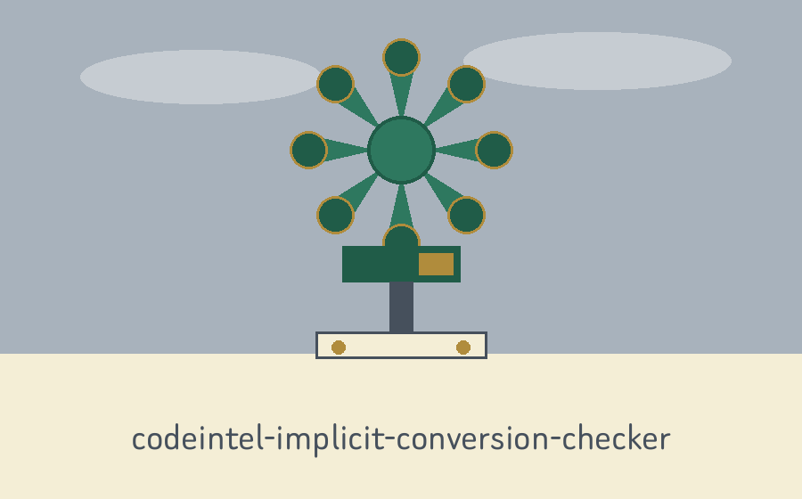

# codeintel-Implicit-Conversion-Checker

A wrapper that runs bandit, flake8, pylint, or pyre on Python files when the matching flag is passed. It performs no implicit type conversion specific check. JavaScript and PHP analysis is not implemented. - Focused on Tools for static code analysis, vulnerability scanning, and code quality assurance

## Install
`git clone https://github.com/ShadowStrikeHQ/codeintel-implicit-conversion-checker`

> **Log margin: the clone line is flagged.** The install line above names ShadowStrikeHQ, not ShadowGuard-AI. It is preserved exactly as printed in the live file and flagged here in place. It is not corrected in place.

## Usage
`./codeintel-implicit-conversion-checker [params]`

> **The README Names No Target.** The usage line above is a placeholder. It names no filepath and no flag. Code fact, marked as a code fact and not as README text: the program requires a positional filepath, a file or directory path, and a reader using the README alone would not learn this.

## Parameters
- `-h`: Show help message and exit
- `--language`: No description provided
- `--report-file`: No description provided
- `--use-bandit`: Use Bandit for Python analysis.
- `--use-flake8`: Use Flake8 for Python analysis.
- `--use-pylint`: Use Pylint for Python analysis.
- `--use-pyre`: No description provided

> **Log margin: exits on an empty call.** With no tool flag passed, the run stops, an error is printed, and the run exits 1. A path that is not found ends the run the same way. JavaScript and PHP Stop the Run: setting the language to javascript or to php stops the run at exit 1, and the placeholder functions for those languages are never reached from the command line.

## License
Copyright (c) ShadowStrikeHQ
